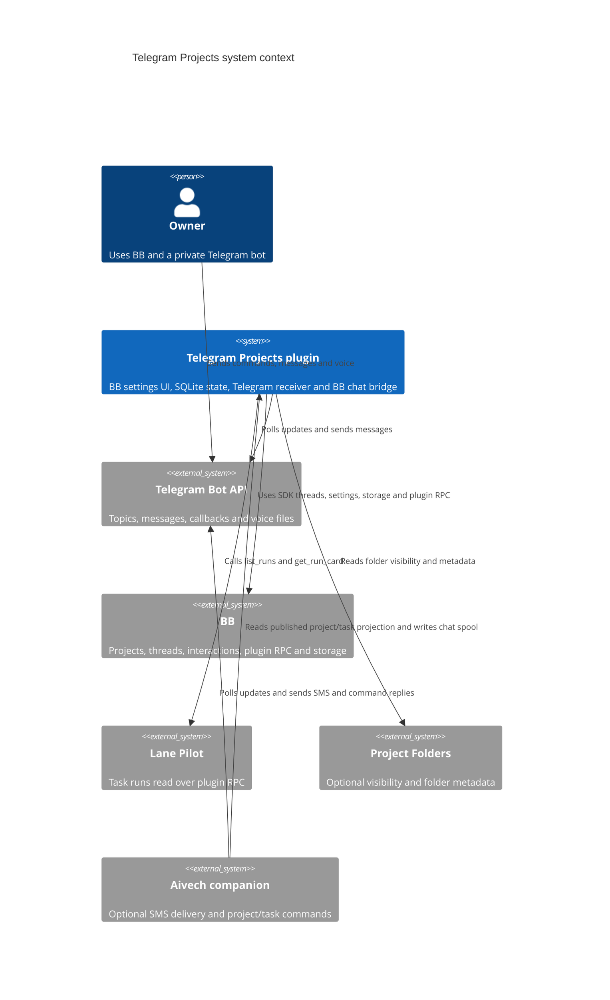

# Architecture

TL;DR: The BB plugin owns Telegram polling, project topic synchronization, event delivery, and chat bridging; the optional companion owns SMS delivery and reads the plugin's published project/task projection.

## System context

## Building blocks

| Block | Responsibility | Evidence |
|---|---|---|
| `server.ts` plugin entry | Defines settings and RPC, creates the SQLite state store, starts polling/sync loops, handles lifecycle and commands. | (server.ts:89-148), (server.ts:149-208), (server.ts:262-292) |
| `app.tsx` settings panel | Loads preferences/status through RPC and renders the plugin tabs; Events lets the operator set event enablement, sound and project filters. | (app.tsx:30-89), (app.tsx:648-707) |
| `ingress.ts` | Filters Telegram updates and creates chat/tasks/pair/refusal/ignore ingress values. | (ingress.ts:14-70) |
| `chat.ts` ChatBridge | Persists per-topic bindings, maps messages to BB threads and sends results back through Telegram. | (chat.ts:129-188) |
| `model.ts` | Defines the state records and reconciles projects, tasks, events and Telegram topics. | (model.ts:1-54), (model.ts:140-183), (model.ts:249-279) |
| `adapters.ts` | Wraps Telegram API, Env Catalog token lookup, Lane Pilot task RPC, and BB voice transcription. | (adapters.ts:12-69), (adapters.ts:138-175), (adapters.ts:176-226) |
| companion | Optional Node service with SMS outbox, bot commands, and projection reader. | (companion/aivech/src/main.ts:11-70), (companion/aivech/src/bot.ts:14-51), (companion/aivech/src/projects.ts:19-32), (companion/aivech/src/locale.ts:222-224) |

## Runtime boundaries

The plugin registers `rpcContract` for preference, connection, pairing, status, sync, topic initialization, event settings, summary defaults, and agency delivery methods. The React panel calls these methods through the typed BB RPC interface. (server.ts:89-148), (app.tsx:44-54)

The plugin uses the Telegram Bot API through a single adapter and polls updates itself. `routeUpdate` accepts only private-chat updates where sender ID equals chat ID; once paired, only the owner reaches chat processing. `/tasks` is classified for plugin handling. (adapters.ts:12-69), (ingress.ts:14-47)

The companion is a separate optional process. It reads Telegram-project state from a JSON projection and reads the SMS inbox database read-only; its own SQLite outbox tracks SMS delivery. The companion handles `/projects`, `/tasks`, and `/status`; chat updates are atomically spooled for the plugin when chat bridging is enabled. (companion/aivech/src/main.ts:20-32), (companion/aivech/src/bot.ts:20-45), (companion/aivech/src/chat.ts:24-81), (companion/aivech/src/projects.ts:19-32)

## Related pages

- [Overview](overview.md)
- [Interaction flow](interaction-0.3.1.md)
- [Data model](data-model.md)
- [Deployment](deployment.md)
- [Gotchas](gotchas.md)

<!-- lane-pilot:backlinks -->
## Referenced by

- [Data model](data-model.md)
- [Deployment](deployment.md)
- [Telegram interaction flow](interaction-0.3.1.md)
- [Telegram Projects overview](overview.md)
- [Telegram integration research](research.md)
- [Use BB from Telegram](usage.md)
