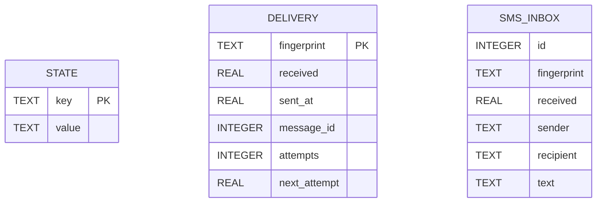

# Data model

TL;DR: The plugin's SQLite database has one physical table, `state(key, value)`. Domain records are JSON values addressed by key prefixes; the companion uses separate databases for SMS inbox and delivery. (server.ts:262-292), (companion/aivech/src/main.ts:20-30)

## Entity map

`key` is the unique storage address. `value` is JSON serialized by `Store.put` and parsed by `Store.get`/`Store.list`. `state` is created by the plugin migration. (server.ts:262-287)

## Table: `state`

Purpose: persistence for project/topic mappings, task snapshots and event queue items, chat bindings/actions, pairing state and preferences stored outside BB settings. The table's `value` is a discriminated JSON record selected by its key prefix. (server.ts:262-292), (model.ts:16-54), (chat.ts:46-90)

| Field | Meaning | Allowed values and origin |
|---|---|---|
| `key` | Primary key and domain namespace. | Text. Keys include `owner:id`, `bot:id`, `pair:code`, `pair:codeAt`, `events:config`, `topic:<key>`, `task:<project>:<task>`, `event:<id>`, `chat:binding:<topicId>`, and `chat:button:<random-id>`. (server.ts:335-359), (chat.ts:164-212), (model.ts:146-160) |
| `value` | JSON-encoded domain value. | Non-null JSON text; parsed into the corresponding TypeScript record. (server.ts:268-287) |

### Stored record meanings

| Record family | Meaning and fields | Writer and reader |
|---|---|---|
| Topic | BB project key/name, Telegram topic ID, creation flag, optional missing timestamp and intro message metadata. Display names are capped at 128 characters. | Topic reconciliation writes records; sync/status and chat binding read them. (model.ts:16-24), (model.ts:190-192), (model.ts:249-279), (chat.ts:173-193) |
| Task snapshot | Lane Pilot task ID, run ID, title, status, attempt ID, blocked reason and run update time. | Lane Pilot reader maps RPC data; ingest compares/stores snapshots; notification formatting reads them. (model.ts:2-14), (adapters.ts:138-173), (model.ts:140-183) |
| Event | Project/task identity, displayed title/tracker/status/kind/time, urgency and optional thread/summary/delivery data. | Ingest and thread-event handling enqueue events; delivery loop reads and marks them. (model.ts:25-47), (model.ts:140-183) |
| Chat binding | Topic/project/thread IDs, revision, ready flag, cursor and optional folder/host/provider/model/profile/progress values. | ChatBridge creates and updates bindings; chat menu and output processing read them. (chat.ts:46-64), (chat.ts:164-195) |
| Button action | Topic and binding revision, action kind, optional arguments, expiry and used flag. | ChatBridge persists it before returning callback data; callback handling validates it. (chat.ts:66-74), (chat.ts:196-212) |
| Pairing and event configuration | Owner and bot IDs, pairing code/time, event rules. | Pairing and settings RPC write them; ingress, sync and event delivery read them. (server.ts:335-359), (server.ts:341-352) |

### Status lifecycles

| Record/status | From | To | Function and condition |
|---|---|---|---|
| Chat inbox item | absent | `pending` | `ChatBridge.accept` stores a first-seen update. Duplicate update IDs are not inserted again. (chat.ts:307-318) |
| Chat inbox item | `pending` | `claimed` | `tick` claims an item before handling it, with one active lane per topic and at most four lanes. (chat.ts:357-371) |
| Chat inbox item | `claimed` | `done` | Handler completion stores a scrubbed input; recovered claimed items become done with text and voice removed. (chat.ts:339-355), (chat.ts:383-388) |
| Button action | `used` absent/false | `used: true` | A callback passes topic, revision and expiry validation; the action is marked used before dispatch. (chat.ts:973-988) |
| Summary worker | `pending` | `done` | `advanceSummaries.finish` receives non-empty worker output and marks the summary done. (server.ts:704-727), (server.ts:760-767) |
| Summary worker | `pending` | `failed` | Missing environment, worker failure, empty output, exception or timeout marks summary failed; full reply remains available. (server.ts:716-727), (server.ts:729-773) |
| Topic | absent | `creating` | `ensureTopic` stores a pending topic before calling Telegram to create it. (model.ts:206-229) |
| Topic | `creating` | `creating: false` | Successful creation stores returned thread ID; definite Telegram failure clears creating; ambiguous failure stays uncertain. (model.ts:223-236) |
| Topic | present | `missingSince` timestamp | `reconcileProjects` marks a missing project on the first complete snapshot; reappearance clears the marker in `ensureTopic`. (model.ts:238-246), (model.ts:257-265) |
| Task snapshot | Any prior status | New latest-attempt status | `ingest` compares status and emits a status event for done/canceled or worker-error for blocked; first observed project snapshot establishes a silent baseline. (model.ts:69-85), (model.ts:140-183) |

### Invariants, retention and cleanup

- The `key` is unique and an update replaces only the matching key. Multi-record changes can use a SQLite transaction through `Store.atomic`. (server.ts:272-291)
- Task events use stable IDs; blocked event identity includes run, task, attempt and run update time so a distinct blocked episode can notify again. (model.ts:146-160)
- Task snapshots absent from the latest project read are removed; snapshots from other projects are retained. Old Tasks-plugin key families are dropped during the one-time migration. (model.ts:177-189)
- Chat button records carry a one-day expiry and binding revision. (chat.ts:196-212)
- Completed chat inbox records and sent chat outbox records are removed after seven days; expired button records are removed during the bridge tick. (chat.ts:420-435)
- Sent-event dedupe receipts are removed after 30 days; task snapshots for runs absent from the latest read are removed. (server.ts:695-698), (model.ts:177-181)
- Pair codes older than 10 minutes are replaced on access. (server.ts:338-352)

## Companion databases

The companion opens an externally produced SMS inbox database read-only and creates an `aivech-outbox.sqlite3` database with a `delivery` table. The inbox table is not created by this repository; the fields below are those selected by the companion. These databases are separate from the plugin database. (companion/aivech/src/main.ts:20-30), (companion/aivech/src/main.ts:169-173)

| Table / field | Meaning | Allowed values and origin |
|---|---|---|
| `sms.id` | Source inbox row identifier used for ordering. | Integer from the external SMS service database. (companion/aivech/src/main.ts:169-173) |
| `sms.fingerprint` | Stable delivery dedupe key. | Text from the external SMS service database. (companion/aivech/src/main.ts:169-180) |
| `sms.received` | Source receive time, Unix seconds. | Real number; rows older than one hour are excluded. (companion/aivech/src/main.ts:164-173) |
| `sms.sender`, `sms.recipient` | SMS sender and destination labels used by formatting. | Text from the external SMS service database. (companion/aivech/src/main.ts:169-173) |
| `sms.text` | Message text passed to SMS formatting. | Text from the external SMS service database. (companion/aivech/src/main.ts:169-173) |
| `delivery.fingerprint` | Primary key joining the outbox receipt to its source message. | Text copied from `sms.fingerprint`. (companion/aivech/src/main.ts:28-30), (companion/aivech/src/main.ts:177-185) |
| `delivery.received` | Source receive time, Unix seconds. | Real number copied from inbox. (companion/aivech/src/main.ts:177-180) |
| `delivery.sent_at` | Successful Telegram delivery time, Unix seconds; null means not yet delivered. | Real number or null. (companion/aivech/src/main.ts:181-198) |
| `delivery.message_id` | Telegram message ID returned on successful send. | Integer, set after `sendMessage`. (companion/aivech/src/main.ts:190-198) |
| `delivery.attempts` | Number of failed send attempts. | Integer, starts at 0 and increments after failure. (companion/aivech/src/main.ts:202-211) |
| `delivery.next_attempt` | Earliest retry time, Unix seconds. | Real number; set from Telegram retry-after or exponential backoff. (companion/aivech/src/main.ts:202-211) |

| Status-like field | From | To | Function and condition |
|---|---|---|---|
| `delivery.sent_at` | null | Unix-seconds timestamp | SMS send succeeds; stores Telegram message ID in the same update. (companion/aivech/src/main.ts:188-200) |
| `delivery.attempts` / `next_attempt` | current retry values | incremented attempt / future timestamp | SMS send fails; HTTP 429 uses retry-after when present, other errors use bounded exponential delay. (companion/aivech/src/main.ts:201-215) |

Delivery records are removed when their source `received` time is older than one hour. The outbox file is created with SQLite `secure_delete=ON` and chmod `0600`; status only counts unsent rows. (companion/aivech/src/main.ts:28-31), (companion/aivech/src/main.ts:46-58), (companion/aivech/src/main.ts:164-168)

## Related pages

- [Architecture](architecture.md)
- [Interaction flow](interaction-0.3.1.md)
- [Gotchas](gotchas.md)

<!-- lane-pilot:backlinks -->
## Referenced by

- [Architecture](architecture.md)
- [Deployment](deployment.md)
- [Gotchas](gotchas.md)
- [Telegram interaction flow](interaction-0.3.1.md)
- [Telegram Projects overview](overview.md)
